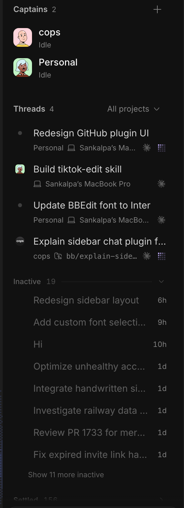
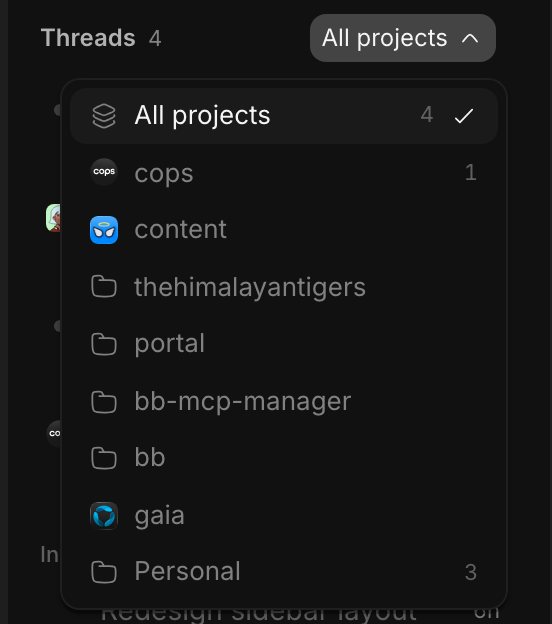
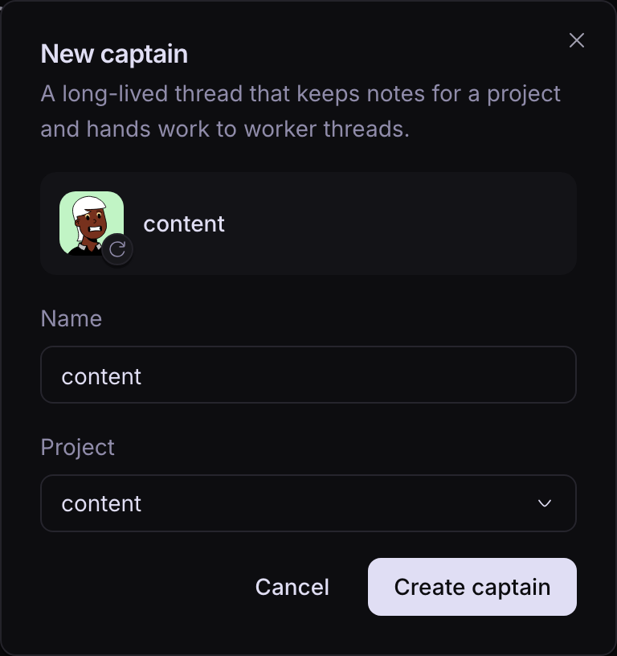

# Armada

Armada is a bb sidebar for people who run many threads at once. Captains, the
long-lived threads that run a project, sit at the top. Every other thread
appears once in a list you can filter by project. Threads you have finished
with move to shelves below the list.



## What the sidebar shows

### Captains

Each captain is one row with its avatar, its name and a summary of its
threads. The summary reads "2 working", "1 needs you", "1 failed" or "Idle".
While any of its threads work, a small shade grid animates at the right. The
**+** next to Captains starts a new captain.

### Threads

Each thread takes two lines. The first line is the thread's title and the mark
to its left. The mark depends on where the thread came from.

- A thread a captain started shows the captain's avatar.
- When that captain's project has a logo too, the logo sits behind the avatar,
  and the avatar overlaps a third of it.
- A thread no captain started shows its project's logo.
- A thread with neither shows a grey dot.

The second line holds the project, then the worktree, branch or machine the
thread runs on, any running workflows or background agents, the pull request
number, and the harness icon. The thread's status comes last.

- The shade grid means the thread is working.
- **Unread** means it finished and you have not opened it. Its title is also
  bold.
- bb's own icons mark a thread that needs you or that failed.

When a thread can be put away, hovering it shows a **Settle** button at the
end of its title line. Right-click a thread for bb's menu, the snooze presets and **Make
captain…**.

Armada finds a project's logo in its repository, the same way T3 Code does. It
looks for a favicon, icon or logo file at the root, then under `public/`,
`app/`, `src/app/` and `static/`, then under `apps/*` and `packages/*`. It reads SVG,
PNG, ICO and WebP files up to 64 KB and checks again every 5 minutes. The
personal project has no repository, so its threads keep the dot.

### The project filter

The menu beside Threads filters the list by project. Each project shows its
logo and how many active threads it has. Clicking a project adds or removes
it, and the menu stays open so you can choose several. **All projects** clears
the choice and closes the menu. The button reads "cops" for one project and
"cops +1" for two. Thread rows hide the project name while exactly one project
is chosen.



### Shelves

Three shelves sit under the list, and each folds open from its label.

- **Inactive** holds threads that have not changed for 6 hours.
- **Snoozed** holds threads you snoozed. They come back when the snooze ends.
- **Settled** holds threads you settled. Armada also settles a thread on its
  own once it has been quiet for 3 days, or when its pull request merges.

A thread that starts working again, or that needs you, returns to the list
whatever shelf it was on. The three numbers are settings in Armada's plugin
settings.

## The Crew tab

In a thread's side panel, the New tab lists **Crew** under Actions. Crew opens
the captain for the thread you are in. That is the thread itself if it is a
captain, the captain that started it, or else the newest captain of its
project. Only when the project has no captain does Crew ask you to pick one.

The tab lists the captain's threads in Active, Inactive and Settled groups,
with the same second line as the sidebar. Clicking a thread opens it. Below
the threads, **Memory** lists the files in the captain's folder.


## Captains and their memory

**+** asks for a name, a project and an avatar, then starts the captain thread.
The name starts as the project's name, and clicking the avatar rolls a new
one.



A captain keeps its memory in `~/.bb/captains/<project>/`, following the
firstmate skill. The folder holds `captain.md`, `learnings.md`, `backlog.md`,
`archive.md`, and a `tasks/<name>/` folder for each piece of work. The Memory
section in Crew lists the `.md` files in that folder, up to two folders deep,
and clicking one opens it in bb's file preview.

A captain hands work to a supervisor thread, and the supervisor starts the
workers. The first line of `backlog.md` names the supervisor
(`Supervisor: thr_…`). Armada reads that line and treats the supervisor as part
of its captain. Workers show as the captain's own threads, and the supervisor
never shows as a row. A new supervisor appears within 5 minutes.

Armada ships the firstmate skill in `skills/firstmate/`, and bb loads every
`skills/<name>/SKILL.md` in a plugin into agent threads. So installing Armada
installs the skill, and nothing else is needed for a captain to work. A new
captain's first prompt tells it to follow `/firstmate` and keep its home at
`~/.bb/captains/<project>/` (`lib/captain-text.ts`). The skill is adapted from
[kunchenguid/firstmate](https://github.com/kunchenguid/firstmate).

## How it works

The server keeps one KV record per captain at `captain:<threadId>` and one per
put-away thread at `park:<threadId>`. A park is `settled { at, by }`,
`snoozed { at, until }` or `kept { at }`. A kept thread is one you moved back
to the list, and auto-settle leaves it alone. Each list method declares a tag, and every write
invalidates it, so the sidebar refreshes after each change and on reconnect.
The client predicts each settle and snooze, so a row leaves the list at once.
The server skips and logs records it cannot read. It also reads older records,
which held a logo and a colour or an Adventurer or anime avatar, as Micah
avatars.

`lib/model.ts` turns bb's threads and projects and these records into the
rows the list draws. Sub-threads fold into their parent, and the parent takes
the most urgent status among them. `lib/forest.ts` holds that folding rule,
including the supervisor rule above. The server's auto-settle job uses the same
rule. `lib/status.ts` is one table that gives each status its rank, word,
colour and mark.

| Method | Input | Output |
| --- | --- | --- |
| `captains_list` | none | captain records |
| `captains_create` | `projectId`, `projectName`, `name`, `avatar` | the record, or the thread if recording it failed |
| `captains_adopt` | `threadId`, `avatar`, `createdAt` | captain record |
| `captains_update` | `threadId`, `avatar` | captain record |
| `captains_remove` | `threadId` | none |
| `parks_list` | none | park records |
| `parks_settle` | `threadId`, `at` | park record |
| `parks_snooze` | `threadId`, `at`, `until` | park record |
| `parks_unpark` | `threadId` | none |
| `parks_keep` | `threadId`, `at` | park record |
| `parks_evaluate` | none | the threads auto-settle just settled |
| `captain_home` | `project` | the memory folder's file list |
| `captain_supervisors` | none | every supervisor's thread id |
| `project_logos` | none | a logo for each project that has one |

`captains_create` starts the thread first and records it second, retrying
after 100 ms and 400 ms. If the record still fails, the dialog switches to
**Record captain**, which records the same thread instead of starting another.

Pull request numbers come from bb's GitHub PR Status plugin. Without it, rows
show no PR numbers. The sidebar remembers the project filter and which shelves
are open in `localStorage`.

## Develop

```
npm install
npm run check     # typecheck, tests, build
bb plugin install /path/to/bb-armada
bb plugin reload armada
```

Then choose **Armada** under Settings, Appearance, Sidebar. To refresh the
screenshots, run bb, open it at `http://127.0.0.1:38886` and capture the
sidebar, the open project filter, the Crew tab and the New captain dialog at
2x.

## Layout

```
app.tsx          registers the sidebar list and the Crew tab
skills/          the firstmate skill, which bb loads into agent threads
server.ts        records, migration, RPC handlers and schedules
lib/             model, folding, status table, shelves, scope, logos, memory reader
hooks/           queries for captains, parks, supervisors and logos, park actions
components/      sections, rows, shelves, Crew tab, Memory, dialog, pickers
components/ui/   bb components copied into the plugin
docs/            screenshots
test/            model, server, shelf, scope and rendered-list tests
```

[THIRD_PARTY_NOTICES.md](THIRD_PARTY_NOTICES.md) lists the code adapted from
other projects.
