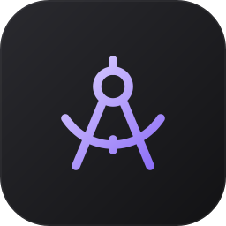
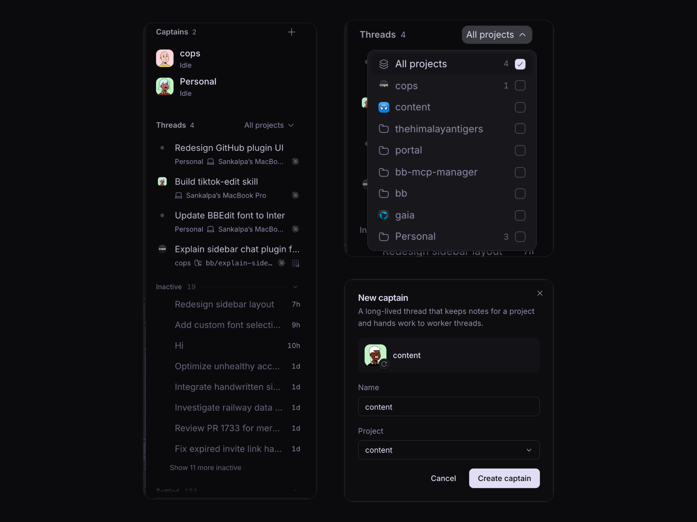
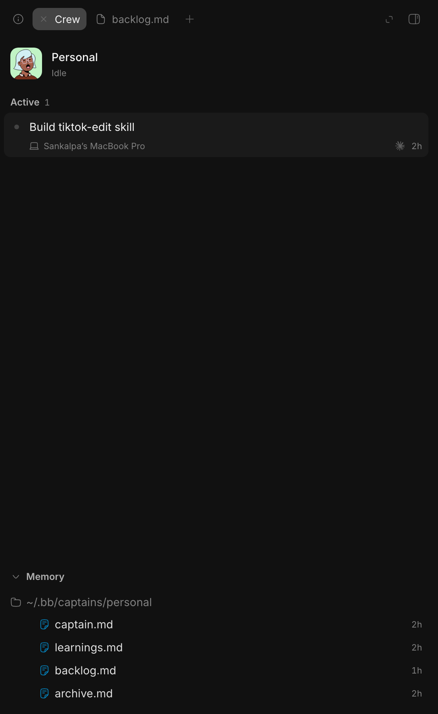

<p align="center">
  
</p>

<h1 align="center">Armada</h1>

<p align="center"><strong>Captains for your projects, and every thread in one list, inside BB.</strong></p>

<p align="center">
  
  
</p>

<p align="center">
  
</p>

Armada replaces BB's sidebar thread list. A captain is a long-lived thread
that runs one project. You tell it what you need, and it starts and watches
worker threads for you. Your captains sit at the top of the sidebar, and the
threads a captain starts stay in its Crew tab. Your own threads sit in the
list below, and finished ones move to shelves.

## Install

```sh
bb plugin install git:https://github.com/sankalpaacharya/bb-armada.git@main
```

Then choose **Armada** under Settings, Appearance, Sidebar. Requires BB 0.48+.
The install includes the `armada` skill that captains run on.

## What you get

- Captains at the top, each with how many of its threads are working, need
  you or failed
- Your own threads in one list, each with its project's logo, and its branch
  or machine, pull request and harness on a second line
- **Unread** on threads that finished while you were away
- A project filter where you can pick several projects
- Inactive, Snoozed and Settled shelves that fill and empty on their own
- A **Crew** tab in the side panel with the threads a captain started and its
  memory files
- **Add to captain** in a thread's menu, to hand the thread to a captain of its project

Start a captain with the **+** next to Captains, or right-click any thread and
choose **Make captain…**. Hover a finished thread for **Settle**, or
right-click it for the snooze presets.

<p align="center">
  
</p>

## Captains

A captain keeps its memory in `~/.bb/captains/<project>/`. It saves how you
like things done, what it learned, its to-do list, and a folder per task. Say
"stow" to make it file everything from the conversation right away, or
"bearings" for a status report. The Crew tab's Memory section shows those
files. [How captains and their memory work](docs/architecture.md).

## Settings

```sh
bb plugin config armada
```

| Key | Default | What it does |
| --- | --- | --- |
| `inactiveAfterHours` | 6 | Hours with no activity before a thread moves to Inactive |
| `autoSettleAfterDays` | 3 | Days quiet before a thread settles on its own |
| `autoSettleOnMerge` | true | Settle a thread when its pull request merges |

Set a number to 0 to turn that rule off.

## Dev

```sh
npm install
npm run check
bb plugin install . --yes
bb plugin reload armada
```

`npm run check` runs the typecheck, the tests and the build.
[docs/architecture.md](docs/architecture.md) covers the storage, the RPC
methods and the code layout. [THIRD_PARTY_NOTICES.md](THIRD_PARTY_NOTICES.md)
lists the code adapted from other projects.
